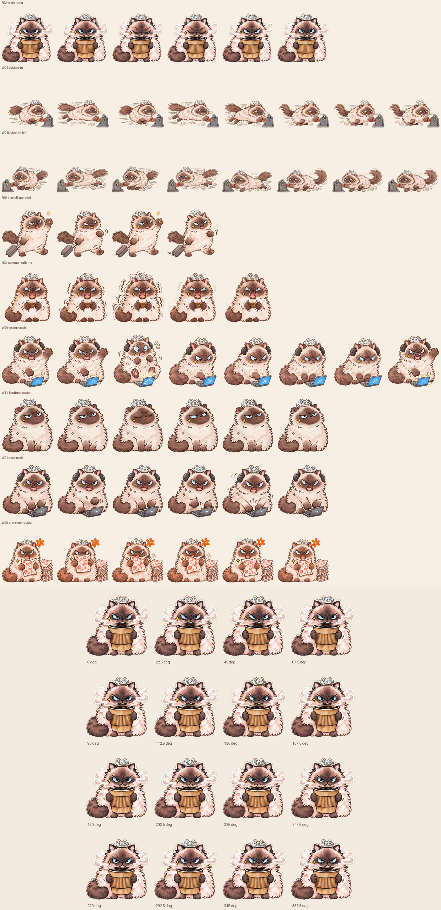

# Turn Your ChatGPT Into a Grumpy Cat

Meet Madge, a watercolor desktop pet who holds a coffee bucket, sprints to clock in, and keeps an eye on your cursor.

## Install

Open the installer on a computer with the ChatGPT desktop app and Pets enabled. Select **Madge · Grumpy Cat** in **Settings → Pets**, then enter `/pet` to show the floating companion.

[Open the desktop installer](codex://pets/install?name=MADGE%20%C2%B7%20Grumpy%20Cat&imageUrl=https%3A%2F%2Fraw.githubusercontent.com%2Fmonacongli-creator%2Fmadge-grumpy-cat-desktop-pet%2Fmain%2Fmadge-grumpy-cat-v2.png&spriteVersionNumber=2)

If the link is unavailable in GitHub, copy this address into your browser.

```text
codex://pets/install?name=MADGE%20%C2%B7%20Grumpy%20Cat&imageUrl=https%3A%2F%2Fraw.githubusercontent.com%2Fmonacongli-creator%2Fmadge-grumpy-cat-desktop-pet%2Fmain%2Fmadge-grumpy-cat-v2.png&spriteVersionNumber=2
```

[Download the full package](turn-your-chatgpt-into-a-grumpy-cat.zip)

## Animations

The package contains 30 Grumpy Cat GIFs, a left-facing sprint variant, and 10 previews exported from the desktop sprite sheet. The previews use the native 192 × 208 sprite cells. The collection GIFs retain the resolution of their source artwork. See GIF-INVENTORY.csv in the package for dimensions and frame counts.

| Slot | Animation |
| --- | --- |
| Idle | R02 Coffee Bucket |
| Run Right / Left | W04 Clock-in Sprint |
| Wave | R10 Lucky Draw |
| Jump | R03 Coffee Tremble |
| Failed | W06 Computer Crash |
| Waiting | Waiting for a Reply |
| Running | W01 Typing |
| Review | R14 Long Voice Message |
| Look | R02 Cursor Follow, 16 Directions |



The ChatGPT desktop app plays the animations from the transparent v2 sprite sheet. This independent character pack is available for personal installation. See [Copyright and permitted use](COPYRIGHT.md).

Artwork by [MADGE](https://meetmadge.com/).
